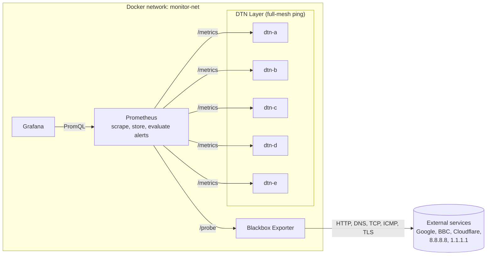

# Deployment and Configuration of an Internet2 Global Network Monitoring and Orchestration Tool

**A reproducible, containerised monitoring lab** demonstrating multi‑protocol probing, distributed DTN node monitoring, alerting and real‑time visualisation using Prometheus, Grafana, and lightweight DTN exporters.

Final-year dissertation project, BSc (Hons) Computer Science for Cybersecurity, Oxford Brookes University.

---

## Project Summary

This repository implements a compact monitoring stack intended for research and teaching. It demonstrates:

- **Active probing** of external services over HTTP, DNS, TCP, ICMP and TLS via Prometheus Blackbox Exporter.
- **Synthetic DTN (Data Transfer Node) nodes** exposing availability, external latency and full-mesh node-to-node latency.
- **Alerting rules** for failed probes, slow responses, expiring TLS certificates, and DTN outages or latency.
- **Centralised collection** with Prometheus and **visualisation** with an auto-provisioned Grafana dashboard.
- **Docker Compose** orchestration, with an **Ansible** playbook for one-command deployment on a clean Ubuntu host.

---

## Architecture Overview



The system is organised into four logical layers:

- **Monitoring Core**: Prometheus (scraping, storage and alert evaluation) and Grafana (visualisation).
- **Blackbox Probing Layer**: Blackbox Exporter modules for HTTP, DNS, TCP, ICMP and TLS.
- **DTN Layer**: five containerised DTN exporters that ping an external host and each other.
- **Presentation Layer**: the provisioned Grafana dashboard **Internet2 Monitoring Dashboard**.

---

## Repository Layout

```
├── docker-compose.yml          # Prometheus, Blackbox, Grafana and five DTN containers
├── playbook.yml                # Ansible: install Docker and start the stack
├── inventory.ini               # Ansible inventory (localhost)
├── prometheus/
│   ├── prometheus.yml          # Scrape jobs
│   └── alert.rules.yml         # Alerting rules
├── blackbox/
│   └── blackbox.yml            # Probe modules
├── dtn/
│   ├── Dockerfile
│   └── exporter.py             # DTN metrics exporter
├── grafana/
│   ├── dashboards/             # Dashboard JSON
│   └── provisioning/
│       ├── datasources/        # Prometheus datasource
│       └── dashboards/         # Dashboard provider
├── docs/                       # Installation and transition notes
└── setup/                      # Development notes and earlier exporter work
```

---

## Quick Start

**Option A: Docker Compose** (requires Docker with the Compose plugin)

```bash
git clone https://github.com/julesmic/Internet2-Monitoring.git
cd Internet2-Monitoring
docker compose up -d --build
```

**Option B: Ansible** (clean Ubuntu host; installs Docker first)

```bash
ansible-playbook -i inventory.ini playbook.yml
```

Then open:

| Service    | URL                          | Notes                                         |
|------------|------------------------------|-----------------------------------------------|
| Grafana    | http://localhost:3000        | Login `admin` / `admin`, then change password |
| Prometheus | http://localhost:9090        | Targets: `/targets`, alerts: `/alerts`        |
| Blackbox   | http://localhost:9115        | Probe debugging                               |

---

## Metrics

| Metric | Source | Description |
|---|---|---|
| `probe_success` | Blackbox | 1 if the probe succeeded |
| `probe_duration_seconds` | Blackbox | Total probe time |
| `probe_http_duration_seconds` | Blackbox | HTTP phase timings |
| `probe_dns_lookup_time_seconds` | Blackbox | DNS resolution time |
| `probe_ssl_earliest_cert_expiry` | Blackbox | TLS certificate expiry (Unix time) |
| `dtn_status` | DTN exporter | 1 while the exporter is running |
| `dtn_latency_ms` | DTN exporter | ICMP latency to 1.1.1.1 |
| `dtn_to_dtn_latency_ms{target}` | DTN exporter | ICMP latency to each peer DTN |
| `dtn_peer_reachable{target}` | DTN exporter | 1 if the peer answered ping |

---

## Alerting

Rules are defined in `prometheus/alert.rules.yml` and evaluated by Prometheus every 15 seconds. Firing alerts appear at http://localhost:9090/alerts and in the **Active Alerts** panel on the Grafana dashboard.

| Alert | Condition | Severity |
|---|---|---|
| `ProbeFailed` | Any Blackbox probe failing for 2 minutes | critical |
| `SlowHttpResponse` | HTTP probe slower than 2s for 5 minutes | warning |
| `TLSCertificateExpiringSoon` | Certificate expires in under 14 days | warning |
| `DTNNodeDown` | Prometheus cannot scrape a DTN for 1 minute | critical |
| `DTNPeerUnreachable` | A DTN cannot ping a peer for 2 minutes | warning |
| `DTNHighLatency` | DTN-to-DTN latency above 50 ms for 5 minutes | warning |

**Try it:** stop a node and watch the alerts fire.

```bash
docker stop dtn-c        # DTNNodeDown fires after ~1 min, DTNPeerUnreachable after ~2 min
docker start dtn-c       # alerts resolve
```

Validate the rules with promtool:

```bash
docker run --rm -v "$PWD/prometheus:/cfg" --entrypoint promtool prom/prometheus check rules /cfg/alert.rules.yml
```

To route notifications (email, Slack, etc.), add an Alertmanager container and an `alerting:` block to `prometheus.yml`.

---

## Extending the Lab

- **Add a DTN node:** add a service to `docker-compose.yml` using `build: ./dtn`, add it to the `dtn_nodes` scrape job, and add its name to `DTN_TARGETS` in `dtn/exporter.py`.
- **Add probe targets:** edit the relevant `blackbox_*` job in `prometheus/prometheus.yml`. Add new probe modules in `blackbox/blackbox.yml`.
- **Add alerts:** add rules to `prometheus/alert.rules.yml`, then restart Prometheus.
- **Add panels:** edit `grafana/dashboards/internet2-dashboard.json`, or build them in the Grafana UI and export the JSON.
